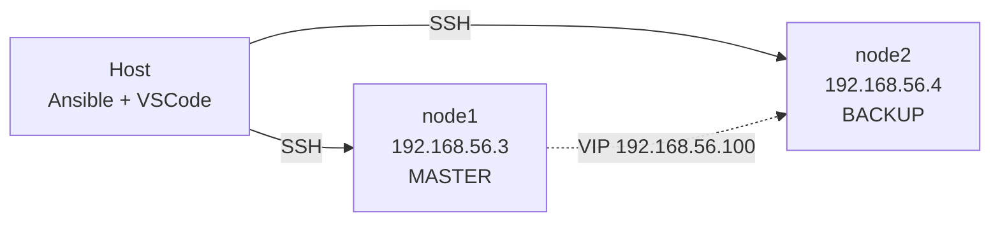

# ansible-lab

Laboratorio de automatización con Ansible sobre dos nodos Ubuntu en VirtualBox.

**Estado:** en construcción. Completadas la base del proyecto (estructura,
inventario, calidad de código) y la Fase 1: instalación de Docker Engine desde el
repositorio oficial y despliegue de nginx en contenedor. Las fases de Ansible
Vault, alta disponibilidad active-passive y Kubernetes (k3s) están planificadas y
se documentarán aquí a medida que se implementen.

## Arquitectura



Los tres nodos comparten el segmento host-only `192.168.56.0/24` de VirtualBox.
`node1` y `node2` son los servidores web; el VIP permite que el tráfico llegue
siempre al nodo activo, sin depender de cuál sea.

## Requisitos

- VirtualBox con dos VMs Ubuntu Server (`node1`, `node2`)
- Ansible 2.21+ en el host
- Python 3 en los nodos
- Linters: `ansible-lint` y `yamllint` (vía `pipx`)

## Estructura

```text
ansible-lab/
├── ansible.cfg                    # Configuración global de Ansible
├── requirements.yml               # Collections requeridas (versiones fijadas)
├── .yamllint                      # Reglas de formato YAML
├── .ansible-lint                  # Perfil y reglas de lint
├── inventory/
│   ├── hosts                      # Inventario estático
│   └── group_vars/
│       └── all.yml                # Variables comunes a todos los hosts
├── playbooks/
│   └── site.yml                   # Orquestador principal
└── roles/
    └── docker/                    # Docker Engine + nginx en contenedor
        ├── defaults/main.yml      #   variables sobreescribibles
        ├── vars/main.yml          #   URLs y listas internas del rol
        ├── tasks/main.yml         #   16 tareas: repo → paquete → deploy
        ├── meta/main.yml          #   metadata del rol
        └── templates/
            ├── docker-compose.yml.j2
            └── index.html.j2      #   página servida por nginx
```

| Ruta | Responsabilidad |
|---|---|
| `ansible.cfg` | Inventario por defecto, `roles_path`, callbacks |
| `requirements.yml` | Declara `community.docker` y `kubernetes.core` con versión exacta |
| `inventory/hosts` | Static inventory con los dos nodos y su usuario SSH |
| `inventory/group_vars/all.yml` | Variables que aplican a todos los hosts |
| `playbooks/site.yml` | Punto de entrada; orquesta por tags |
| `roles/docker/` | Rol único del proyecto: instala Docker y despliega nginx |

## Rol `docker`

Instala Docker Engine desde el repositorio oficial de Docker y despliega un
contenedor nginx. El flujo completo es:

```text
prerrequisitos APT
  → directorio /etc/apt/keyrings
  → descarga de la GPG key oficial
  → repo deb822 (con signed_by a la key local)
  → cache APT
  → docker-ce, containerd.io, buildx y compose plugin
  → servicio habilitado y arrancado
  → usuario agregado al grupo docker
  → render de docker-compose.yml.j2
  → docker compose up
```

| Pieza | Responsabilidad |
|---|---|
| `defaults/main.yml` | Valores que el usuario puede sobreescribir (puerto, imagen, directorio) |
| `vars/main.yml` | URLs y listas internas del rol, con precedencia sobre `defaults/` |
| `tasks/main.yml` | 14 tareas idempotentes en el orden indicado arriba |
| `templates/docker-compose.yml.j2` | Renderiza el compose aplicando Jinja2 sobre variables anidadas |
| `meta/main.yml` | Metadata del rol: versión mínima, plataformas, dependencias |

**El repo de Docker usa el formato deb822**, el nativo de Ubuntu 24.04+, a través
del módulo `deb822_repository`. Este módulo no acepta un string de repo completo:
requiere los campos `name`, `types`, `uris`, `suites`, `components` y `signed_by`
por separado. `name` es obligatorio porque de él derivan tanto el archivo
`.sources` como su firma `.sources.gpg`.

## Ejecución

```bash
# 1. Instalar las collections declaradas
ansible-galaxy install -r requirements.yml

# 2. Verificar que el inventario se resuelve
ansible-inventory -i inventory/hosts --graph

# 3. Verificar conectividad con los nodos
ansible all -m ping

# 4. Desplegar el stack de contenedores
ansible-playbook playbooks/site.yml --tags docker

# 5. Comprobar que nginx sirve la página custom en ambos nodos
curl http://192.168.56.3:8080    # debe mostrar "Nodo: node1"
curl http://192.168.56.4:8080    # debe mostrar "Nodo: node2"
```

Desde la raíz del repositorio: `ansible.cfg` solo se lee si el playbook se ejecuta
desde allí, o si se define `ANSIBLE_CONFIG`.

**Verificar el tipo de archivo montado.** Un bind mount falla de forma confusa si
el path del host existe como directorio en vez de archivo:

```bash
ansible node1 -m command -a "stat -c '%F' /opt/web/html/index.html"
# esperado: regular file
```

## Validación

```bash
yamllint .                                              # formato YAML
ansible-lint                                            # reglas de Ansible
ansible-inventory -i inventory/hosts --graph            # estructura del inventario
ansible-playbook playbooks/site.yml --syntax-check      # sintaxis del playbook
```

El proyecto exige el perfil `production` de `ansible-lint`, el mismo que usan
proyectos de producción en la industria. Las reglas que se consideran demasiado
estrictas durante el aprendizaje están degradadas a warning en `warn_list`,
en vez de desactivarse.

**Idempotencia.** Correr el playbook dos veces seguidas debe dar `changed=0` en la
segunda ejecución. Es la prueba de que la automatización es predecible. Estado
actual del tag `docker`:

```text
node1 : ok=16  changed=0  unreachable=0  failed=0
node2 : ok=16  changed=0  unreachable=0  failed=0
```

El primer despliegue sí produce `changed`, porque el repositorio de Docker todavía
no existía en los nodos.

**`changed=0` no significa "todo bien".** Durante el desarrollo de la página custom,
varias ejecuciones dieron `ok=14 changed=0` mientras el sitio estaba caído: la tarea
de render reportaba éxito sobre un directorio en vez de un archivo. Un `PLAY RECAP`
verde no reemplaza un `curl` que pruebe el resultado.

## Variables

Las variables del rol viven en sus `defaults/`; `inventory/group_vars/all.yml` está
preparado para lo común a ambos nodos y hoy solo aporta `timezone`.

| Variable | Tipo | Ubicación | Propósito |
|---|---|---|---|
| `docker_nginx_config.port` | int | `defaults/` | Puerto publicado en el host |
| `docker_nginx_config.image.name` | string | `defaults/` | Nombre de la imagen |
| `docker_nginx_config.image.tag` | string | `defaults/` | Tag de la imagen |
| `docker_nginx_config.image.ports` | list | `defaults/` | Mapeos de puertos del contenedor |
| `docker_nginx_config.page_title` | string | `defaults/` | Título de la página custom |
| `docker_compose_dir` | string | `defaults/` | Directorio del proyecto compose |
| `docker_content_dir` | string | `defaults/` | Directorio del contenido web montado |
| `docker_packages` | list | `vars/` | Paquetes a instalar |
| `docker_gpg_url` | string | `vars/` | URL de la GPG key oficial |

Criterio: **un solo valor → escalar; varios datos que viajan juntos → `list` o
`dict`.** Un diccionario para un valor aislado es sobre-ingeniería. `port`,
`page_title` e `image` viajan juntos porque describen el mismo servicio, así que
un solo `dict` es coherente; `docker_compose_dir` y `docker_content_dir` viven
sueltos porque son rutas de la plataforma, no del servicio.

**Contenido montado como directorio.** El compose monta `./html` sobre
`/usr/share/nginx/html`, no un archivo suelto:

```yaml
volumes:
  - ./html:/usr/share/nginx/html:ro
```

Montar el directorio —y no `./html/index.html`— es obligatorio. `template` escribe
en un archivo temporal y hace `rename` al final, lo que crea un **inode nuevo**.
Un bind mount de un archivo captura el **inode** al montarse, no la ruta, así que
reemplazar el archivo deja al contenedor leyendo el contenido viejo indefinidamente.
Montando el directorio, el inode del directorio no cambia y nginx sí ve el archivo
nuevo.

**Precedencia.** Las variables del rol viven en dos capas: `defaults/main.yml`
puede ser sobreescrito por `group_vars/`, por variables del play o por
`--extra-vars`; `vars/main.yml` tiene precedencia sobre `defaults/` y no debería
ser modificada por quien usa el rol. Por eso la configuración de nginx está en
`defaults/` y las URLs internas de Docker en `vars/`.

Todas las variables de un rol llevan prefijo con el nombre del rol
(`docker_*`). Sin él, dos roles con una variable `port` colisionarían en silencio
y el último en cargarse ganaría.

## Decisiones de diseño

- **`group_vars/` junto al inventario.** Ansible también carga `group_vars/` en la
  raíz del proyecto; se eligió la ubicación adyacente al inventario por ser la
  convención más extendida y reducir ambigüedad sobre qué archivo aplica a qué grupo.
- **`k3s` en lugar de `kubeadm`.** Las VMs tienen 2 GB de RAM y 1 vCPU.
  k3s cabe dentro de ese presupuesto; kubeadm exigiría añadir al menos un nodo
  más y afinar el consumo para que el clúster quedara estable.
- **keepalived en modo unicast.** El heartbeat VRRP por multicast no es fiable en el
  segmento host-only de VirtualBox. Configurar `unicast_src_ip` y `unicast_peer`
  hace el mecanismo determinista. Las prioridades por host viven en `host_vars/`.
- **Identidad de git local, no global.** Configurada con `git config --local` para
  que el correo no se propague a otros repositorios del sistema.
- **`deb822_repository` en lugar de `apt_repository`.** El formato de una línea
  que escribe `apt_repository` está en desuso frente al deb822 nativo de Ubuntu
  24.04+. Es la dirección en la que va el ecosistema.
- **`cache_valid_time` en lugar de `update_cache` siempre.** `update_cache: true`
  sin ventana de validez marca `changed` en cada ejecución y rompe la
  idempotencia. Con `cache_valid_time: 3600` solo refresca cuando el caché
  realmente expiró.
- **`ansible-lint` con perfil `production`.** Es el estándar de la industria y
  fuerza el uso de FQCN, nombres en todas las tareas y `mode` explícito en archivos.
- **Secretos fuera del repositorio.** `.gitignore` excluye archivos de Vault,
  kubeconfigs y `*.retry`. Cualquier credencial real va en variables cifradas,
  nunca en texto plano.

## Lecciones aprendidas

- **`ansible.cfg` solo se aplica donde se ejecuta.** Un archivo en la raíz no
  afecta a playbooks corridos desde otro directorio.
- **YAML es sensible a la posición del `:`.** Un espacio de más o de menos en la
  indentación produce errores que apuntan a la línea equivocada. Conviene leer la
  estructura antes que el mensaje del parser.
- **El linter valida su propia configuración.** Un `.ansible-lint` mal indentado
  degrada el perfil efectivo de `production` a `min` sin avisar con claridad.
- **Los corchetes importan en los tags de reglas.** `name[template]` degrada la
  regla; `nametemplate` la deja de aplicación y falla el archivo.
- **`ansible-lint` no lee `.gitignore`.** Cada herramienta excluye directorios por
  su cuenta: `yamllint` usa `ignore:` y `ansible-lint` usa `exclude_paths:`.
- **El punto anida en Jinja2, no en YAML.** Escribir `galaxy_info.role_name` crea
  una clave literal llamada así, no un campo `role_name` dentro de `galaxy_info`.
  En YAML la jerarquía se expresa solo con indentación. El error se manifiesta como
  `'x.y' is not a valid attribute for a RoleMetadata`.
- **Un template Jinja2 puede renderizar YAML inválido.** Que las variables se
  expandan correctamente no garantiza que el archivo resultante tenga la
  estructura correcta: un `ports:` sin guion de lista renderiza un escalar en vez
  de una lista. Conviene validar el render con `yamllint` antes de conectarlo al
  playbook.
- **Los números que parecen número van entre comillas en YAML.** `version: 5.2.2`
  sin comillas se interpreta como float. Aplica igual a `min_ansible_version` o a
  los tags de imagen.
- **`force: true` no arregla un `dest` que es un directorio.** Con `dest` apuntando
  a un directorio, el módulo `template` hace early-return y reporta `ok` sin
  escribir nada; con `force` no lo reemplaza, lo interpreta como directorio destino
  y deposita el archivo fuente **dentro** (`index.html/index.html.j2`). El módulo
  nunca borra el path. La solución es eliminar el directorio.
- **Un bind mount de un archivo queda obsoleto cuando `template` lo reemplaza.**
  `template` escribe en un temporal y hace `rename`, lo que genera un inode nuevo.
  El bind mount retiene el inode original, así que el contenedor sigue sirviendo el
  contenido viejo para siempre. Montar el **directorio** evita el problema porque
  su inode no cambia.
- **`inventory_hostname` es el nombre del inventario, no la IP.** Si el inventario
  declara `192.168.56.3 ansible_user=node1`, entonces `inventory_hostname` vale
  `192.168.56.3` y `ansible_user` vale `node1`: son cosas distintas. Declarar
  `node1 ansible_host=192.168.56.3 ansible_user=node1` hace que cada variable
  responda a su pregunta natural.
- **Un grupo y un host no pueden llamarse igual.** `[node1]` con un host `node1`
  produce `Found both group and host with same name`. Se usó un grupo `lab` que
  contiene a los dos hosts.
- **`changed=0` no prueba que el sistema esté sano.** `ok=14 changed=0 failed=1` es
  un `PLAY RECAP` que parece verde mientras el servicio está caído. El resumen mide
  cambios declarados por Ansible, no el estado real del sistema.

## Roadmap

| Fase | Contenido | Estado |
|---|---|---|
| 0 | Estructura, inventario, lint, variables | Completada |
| 1 | Docker Engine + nginx con página custom en Jinja2 | Completada |
| 2 | Ansible Vault + Basic Auth (htpasswd + handler reload) | Completada |
| 3 | Active-passive con keepalived (VIP 192.168.56.100, unicast, auth PASS) | Completada |
| 4 | Clúster k3s (server + agent) | Completada |