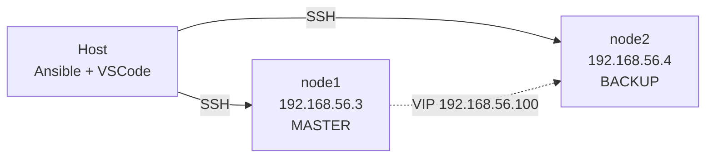

# ansible-lab

Laboratorio de automatización con Ansible sobre dos nodos Ubuntu en VirtualBox.

**Estado:** en construcción. La base del proyecto (estructura, inventario, calidad
de código) está completa. Las fases de Docker, alta disponibilidad active-passive,
Kubernetes (k3s) y Ansible Vault están planificadas y se documentarán aquí a medida
que se implementen.

## Arquitectura



Los tres nodos comparten el segmento host-only `192.168.56.0/24` de VirtualBox.
`node1` y `node2` son los servidores web; el VIP permite que el tráfico llegue
siempre al nodo activo, sin depender de cuál sea.

## Requisitos

- VirtualBox con dos VMs Ubuntu Server (`node1`, `node2`)
- Ansible 2.21+ en el host
- Python 3 en los nodos
- Linters: `ansible-lint` y `yamllint` (vía `pipx`)

## Estructura

```text
ansible-lab/
├── ansible.cfg                    # Configuración global de Ansible
├── requirements.yml               # Collections requeridas (versiones fijadas)
├── .yamllint                      # Reglas de formato YAML
├── .ansible-lint                  # Perfil y reglas de lint
├── inventory/
│   ├── hosts                      # Inventario estático
│   └── group_vars/
│       └── all.yml                # Variables comunes a todos los hosts
├── playbooks/
│   └── site.yml                   # Orquestador principal
└── roles/
    └── python/
        └── tasks/main.yml         # Rol base: Python + directorio de prueba
```

| Ruta | Responsabilidad |
|---|---|
| `ansible.cfg` | Inventario por defecto, `roles_path`, callbacks |
| `requirements.yml` | Declara `community.docker` y `kubernetes.core` con versión exacta |
| `inventory/hosts` | Static inventory con los dos nodos y su usuario SSH |
| `inventory/group_vars/all.yml` | Variables que aplican a todos los hosts |
| `playbooks/site.yml` | Punto de entrada; luego orquestará por tags |
| `roles/` | Roles reutilizables, uno por tecnología |

## Ejecución

```bash
# 1. Instalar las collections declaradas
ansible-galaxy install -r requirements.yml

# 2. Verificar que el inventario se resuelve
ansible-inventory -i inventory/hosts --graph

# 3. Verificar conectividad con los nodos
ansible all -m ping

# 4. Ejecutar
ansible-playbook playbooks/site.yml
```

Desde la raíz del repositorio: `ansible.cfg` solo se lee si el playbook se ejecuta
desde allí, o si se define `ANSIBLE_CONFIG`.

## Validación

```bash
yamllint .                                              # formato YAML
ansible-lint                                            # reglas de Ansible
ansible-inventory -i inventory/hosts --graph            # estructura del inventario
ansible-playbook playbooks/site.yml --syntax-check      # sintaxis del playbook
```

El proyecto exige el perfil `production` de `ansible-lint`, el mismo que usan
proyectos de producción en la industria. Las reglas que se consideran demasiado
estrictas durante el aprendizaje están degradadas a warning en `warn_list`,
en vez de desactivarse.

Idempotencia: correr un playbook dos veces seguidas debe dar `changed=0` en la
segunda ejecución. Es la prueba de que la automatización es predecible.

## Variables

`inventory/group_vars/all.yml` define lo común a ambos nodos:

| Variable | Tipo | Propósito |
|---|---|---|
| `timezone` | string | Zona horaria de los nodos |
| `base_packages` | list | Paquetes base instalados con `apt` |
| `nginx_config.port` | int | Puerto del servidor web |
| `nginx_config.image` | dict | Nombre, tag y puertos de la imagen Docker |

Criterio: **un solo valor → escalar; varios datos que viajan juntos → `list` o
`dict`.** Un diccionario para un valor aislado es sobre-ingeniería.

## Decisiones de diseño

- **`group_vars/` junto al inventario.** Ansible también carga `group_vars/` en la
  raíz del proyecto; se eligió la ubicación adyacente al inventario por ser la
  convención más extendida y reducir ambigüedad sobre qué archivo aplica a qué grupo.
- **`k3s` en lugar de `kubeadm`.** Las VMs tienen 2 GB de RAM y 1 vCPU.
  k3s cabe dentro de ese presupuesto; kubeadm exigiría añadir al menos un nodo
  más y afinar el consumo para que el clúster quedara estable.
- **keepalived en modo unicast.** El heartbeat VRRP por multicast no es fiable en el
  segmento host-only de VirtualBox. Configurar `unicast_src_ip` y `unicast_peer`
  hace el mecanismo determinista. Las prioridades por host viven en `host_vars/`.
- **Identidad de git local, no global.** Configurada con `git config --local` para
  que el correo no se propague a otros repositorios del sistema.
- **`ansible-lint` con perfil `production`.** Es el estándar de la industria y
  fuerza el uso de FQCN, nombres en todas las tareas y `mode` explícito en archivos.
- **Secretos fuera del repositorio.** `.gitignore` excluye archivos de Vault,
  kubeconfigs y `*.retry`. Cualquier credencial real va en variables cifradas,
  nunca en texto plano.

## Lecciones aprendidas

- **`ansible.cfg` solo se aplica donde se ejecuta.** Un archivo en la raíz no
  afecta a playbooks corridos desde otro directorio.
- **YAML es sensible a la posición del `:`.** Un espacio de más o de menos en la
  indentación produce errores que apuntan a la línea equivocada. Conviene leer la
  estructura antes que el mensaje del parser.
- **El linter valida su propia configuración.** Un `.ansible-lint` mal indentado
  degrada el perfil efectivo de `production` a `min` sin avisar con claridad.
- **Los corchetes importan en los tags de reglas.** `name[template]` degrada la
  regla; `nametemplate` la deja de aplicación y falla el archivo.
- **`ansible-lint` no lee `.gitignore`.** Cada herramienta excluye directorios por
  su cuenta: `yamllint` usa `ignore:` y `ansible-lint` usa `exclude_paths:`.

## Roadmap

| Fase | Contenido | Estado |
|---|---|---|
| 0 | Estructura, inventario, lint, variables | Completada |
| 1 | Docker + nginx con Jinja2 y handlers | Pendiente |
| 2 | Ansible Vault para secretos | Pendiente |
| 3 | Active-passive con nginx + keepalived | Pendiente |
| 4 | Clúster k3s (server + agent) | Pendiente |